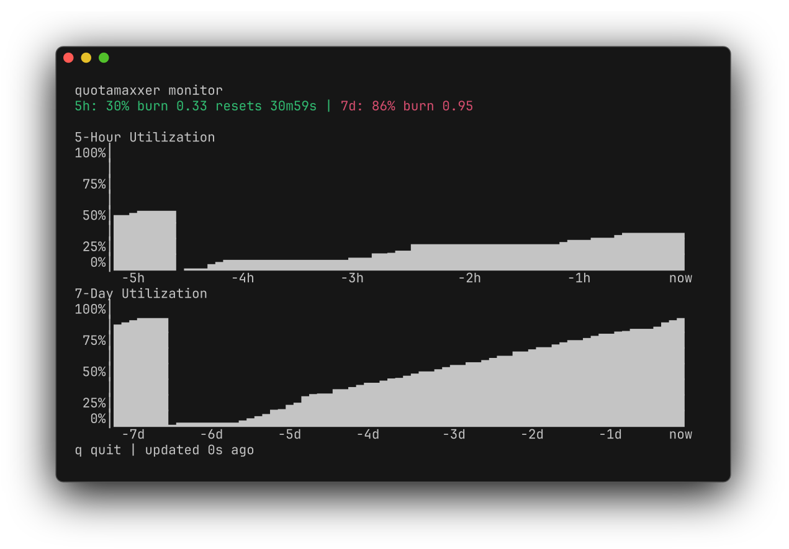

<div align="center">

# Ralph Quotamaxxer

**You paid for the tokens. Use all of them.**

Rate limit-aware pacing for Claude Code. Lets autonomous loops burn right up
to your quota ceiling and coast until it resets.

[](https://go.dev)
[](LICENSE)
[]()

[Install](#install) | [Usage](#usage) | [How it works](#how-it-works)

</div>

---

## What it is

A drop-in replacement for `claude` that tracks your rate limits. If your burn rate is too high, it waits for it to come back down. If you start using Claude yourself, ralph loops using `quotamaxxer` automatically back off to make room, then ramp back up when you stop.

A ralph loop looks like this:

```bash
while true; do
  # waits if you're burning quota too fast, runs immediately if there's headroom
  quotamaxxer --threshold-5h 0.8 --threshold-7d 0.9 -- -p "do work"
done
```

## Install

```bash
curl -fsSL https://raw.githubusercontent.com/brandjas/ralph-quotamaxxer/main/install-remote.sh | bash
```

<details>
<summary><b>Install from source</b> (requires Go 1.24+)</summary>

```bash
git clone https://github.com/brandjas/ralph-quotamaxxer.git
cd ralph-quotamaxxer
./install.sh
```
</details>

<details>
<summary><b>Supported platforms</b></summary>

| OS | Arch |
|---|---|
| Linux | amd64, arm64 |
| macOS | amd64 (Intel), arm64 (Apple Silicon) |

</details>

Everything installs into `~/.claude/ralph-quotamaxxer/`, so it works inside devcontainers that bind-mount `~/.claude`. Multiple sessions (interactive, headless, across containers) can run concurrently and share the same usage data.

```bash
alias claude='~/.claude/ralph-quotamaxxer/bin/quotamaxxer --'
```

`quotamaxxer` is a single Go binary. It runs `claude` as a child (after the guard, if you set thresholds) and propagates exit codes correctly. Then [set up the statusline](#statusline) so interactive sessions and background agents are tracked too.

## Statusline

Interactive sessions and background agents record usage through Claude Code's statusline, which receives the same rate limit data on every update. Pick one:

**Use quotamaxxer's statusline** (shows model, context, cost, and quota with burn indicators):

```json
{
  "statusLine": { "type": "command", "command": "~/.claude/ralph-quotamaxxer/bin/quotamaxxer statusline" }
}
```

**Keep your own statusline** and add one line that records usage without printing anything:

```bash
input=$(cat)
printf '%s' "$input" | ~/.claude/ralph-quotamaxxer/bin/quotamaxxer statusline --persist-only >/dev/null 2>&1
# ... your existing statusline, reading from "$input" ...
```

Put either in `~/.claude/settings.json`. Because the statusline runs in every Claude Code session, this also tracks sessions you start with plain `claude`. When quotamaxxer launches an interactive session and finds no statusline that runs `quotamaxxer statusline`, it prints a one-line reminder (hide it with `--quiet`).

## Monitor

Live TUI dashboard for watching your rate limits:

```bash
quotamaxxer monitor
```



Shows 5-hour and 7-day utilization sparklines with current burn rates, time until reset, and color-coded stats. Backfills from history on startup, polls every 2 seconds. Press `q` to quit.

## Usage

> [!IMPORTANT]
> The guard can only pace against usage it has seen. Interactive sessions and background agents are recorded by the [statusline](#statusline); headless `-p` runs are recorded by quotamaxxer's proxy, so run those **through `quotamaxxer`** (the simplest way is to [alias `claude`](#install)). A headless run started with plain `claude -p` isn't tracked, and the guard will underestimate your usage.

Without threshold flags, it just runs claude and records rate limits:

```bash
quotamaxxer              # interactive
quotamaxxer -p "..."     # headless
```

With threshold flags, it waits until your burn rate dips below the threshold before running:

```bash
quotamaxxer --threshold-5h 0.8 --threshold-7d 0.9 -- -p "..."
```

The guard is also available as a standalone command. It blocks until there's headroom, then exits:

```bash
quotamaxxer guard --threshold-5h 0.8 --threshold-7d 0.9 && \
echo "🚀 quota headroom available, let's go"
```


<details>
<summary><b>Flags</b> (before any claude arguments, or after <code>guard</code>)</summary>

| Flag | Description |
|---|---|
| `--threshold-5h <ratio>` | Wait until 5h burn ratio drops below this |
| `--threshold-7d <ratio>` | Wait until 7d burn ratio drops below this |
| `--wait-timeout <dur>` | Max guard wait time (e.g. `30m`, `1h`). Exit 1 if exceeded. Default: forever |
| `--run-timeout <dur>` | Max claude run time (e.g. `2h`). Sends SIGTERM, then SIGKILL after 10s. Exit 124 if exceeded. Headless only. Default: forever |
| `--source <src>` | Data source: `both` (default; newest of the two), `proxy`, `statusline` |
| `--data-dir <path>` | Data directory. Default: `$QUOTAMAXXER_DATA_DIR`, else `~/.claude/ralph-quotamaxxer/data` |
| `--claude-command <cmd>` | Command to run instead of `claude` (not available on `guard`) |
| `--persistent` | Use the [persistent proxy](#persistent-proxy-optional) for this launch (same as `QUOTAMAXXER_PERSISTENT=1`) |
| `--quiet` | Suppress waiting output and the statusline setup hint |
| `--help` | Show help |

The `guard` subcommand requires at least one `--threshold-*` flag.

quotamaxxer flags must come first. The first argument quotamaxxer doesn't recognize, and everything after it, goes to `claude` unchanged. Use `--` to separate explicitly, e.g. when a claude argument would collide with a quotamaxxer flag name (`quotamaxxer -- --help` shows claude's help).

</details>

## What you get

After each API call, rate limit data is written to `~/.claude/ralph-quotamaxxer/data/`:

| File | Contents |
|---|---|
| `usage-proxy.json` | Latest rate limit snapshot from the proxy (headless runs) |
| `usage-statusline.json` | Latest rate limit snapshot from the statusline (interactive sessions, background agents) |
| `usage-history.jsonl` | Append-only history from both (rotation disabled by default) |
| `persistent-proxy.key`, `persistent-proxy.log` | Only with the [persistent proxy](#persistent-proxy-optional): its secret and its log |

The guard and monitor use whichever snapshot is newer (`--source both`, the default).

## Configuration

All via environment variables, no config files:

| Variable | Default | Purpose |
|---|---|---|
| `QUOTAMAXXER_DATA_DIR` | `~/.claude/ralph-quotamaxxer/data` | Data directory |
| `QUOTAMAXXER_UPSTREAM` | `$ANTHROPIC_BASE_URL`, else `https://api.anthropic.com` | Where the headless proxy forwards to (the standalone `proxy` subcommand ignores `ANTHROPIC_BASE_URL`) |
| `QUOTAMAXXER_PORT` | `0` (OS-assigned) | Proxy listen port (standalone `proxy` subcommand only) |
| `QUOTAMAXXER_MAX_HISTORY_BYTES` | `0` (disabled) | History rotation threshold (0 = no rotation) |
| `QUOTAMAXXER_PERSISTENT` | unset (off) | Set to `1` to route every session through the [persistent proxy](#persistent-proxy-optional) |
| `QUOTAMAXXER_PERSISTENT_PORT` | `28429` | Loopback port of the persistent proxy |

## How it works

`quotamaxxer` runs the guard (if you set thresholds), then runs `claude` as a child process. Usage is recorded in one of two ways, depending on whether the session has a UI:

- **Interactive sessions and background agents (`--bg`, `/background`)** record usage through the [statusline](#statusline). Claude Code passes the current `rate_limits` to the statusline command on every update, and `quotamaxxer statusline` writes them to disk. quotamaxxer doesn't touch `ANTHROPIC_BASE_URL` for these sessions, so background agents and Claude Code's background service never depend on a quotamaxxer process staying alive.
- **Headless runs (`-p`, or no terminal)** have no statusline, so quotamaxxer starts an in-process reverse proxy on an ephemeral port and points Claude Code at it via `ANTHROPIC_BASE_URL`. The proxy sits between Claude Code and `api.anthropic.com`, extracting `anthropic-ratelimit-unified-*` headers from every response and writing them to disk. No body inspection, no header mutation, SSE streaming passes through, and upstream errors (including 429s) are forwarded as-is. The proxy uses only the Go standard library and lives exactly as long as the run.

By default there are no daemons, PID files, or port conflicts, and nothing runs when Claude isn't running. All state lives in `~/.claude/ralph-quotamaxxer/`, so it works across devcontainers that bind-mount `~/.claude`.

**Limitation:** headless runs launched through quotamaxxer can't start background agents. quotamaxxer sets `CLAUDE_CODE_DISABLE_AGENT_VIEW=1` for them, because an agent would inherit the run's proxy address and lose its connection when the run ends.

### Persistent proxy (optional)

The default above needs no setup beyond the statusline and leaves nothing running. If you would rather have **every** session go through the proxy (interactive sessions and background agents too), turn on the persistent proxy:

```bash
export QUOTAMAXXER_PERSISTENT=1    # e.g. in your shell profile, next to the claude alias
```

With it on, the first launch starts a small detached `quotamaxxer daemon` on a fixed loopback port (`127.0.0.1:28429`) and points Claude Code at it. Because the address never changes, background agents keep working after the session that started them has exited, which is what the per-run proxy can't offer. Compared to the statusline, the proxy records every API response as it happens, including the headers the statusline doesn't expose, and doesn't depend on a statusline being configured. The statusline keeps working alongside it, and the guard merges both.

- **Nothing to install.** The daemon is the same binary, started on demand. It runs until you stop it (`quotamaxxer daemon stop`). `quotamaxxer daemon status` shows whether it is up.
- **Self-healing.** If the daemon is gone, the next launch starts it again, and so does the statusline of any session that was started through it, so a long-lived background agent recovers by itself.
- **Upgrades.** After installing a new build, the next launch replaces the running daemon. The old one frees the port immediately and finishes the requests it is still streaming.
- **Fails open.** If the daemon can't be used (for example because something else holds the port), quotamaxxer prints a warning and behaves exactly as it does by default. It never stops Claude from starting.
- **Other upstreams.** If you launch with an `ANTHROPIC_BASE_URL` of your own (a gateway), each session's upstream travels in its proxy URL, so one daemon serves sessions with different upstreams.
- **Containers.** Each network namespace gets its own daemon; they share the data files in a bind-mounted `~/.claude` safely.

Things to know before turning it on:

- **Launch consistently.** Claude Code's background service remembers the API endpoint it was started with. A background session started or resumed with a different `ANTHROPIC_BASE_URL` than that service has (through plain `claude` when the service was started through quotamaxxer, or the other way round) is run by Claude Code *without* the proxy. It still works and the statusline still records it, but the proxy doesn't see it. Use the `claude` alias everywhere, and restart the background service once after turning the option on or off so it picks up the change (`claude daemon stop --any`; note that this also ends running background sessions, which you can resume afterwards).
- **Shared machines.** The port is only reachable from the local machine, and the daemon proves to each launcher that it holds a secret from your data directory before it is used. That stops a launch from being pointed at another user's process, but a session that is already running keeps talking to the port, so if the daemon is down, another local user could listen there and receive that session's requests, credentials included. Don't enable this on a machine you share with users you don't trust.

<details>
<summary><b>History schema</b></summary>

Both sources append to `usage-history.jsonl` with a common core:

```json
{
  "source": "proxy | statusline",
  "timestamp": "2026-03-26T12:00:00Z",
  "epoch": 1774526400,
  "status": "allowed | allowed_warning | rejected",
  "five_hour": { "utilization": 0.04, "reset": 1774540800 },
  "seven_day": { "utilization": 0.77, "reset": 1774828800 }
}
```

Source-specific fields:

- **Proxy:** `representative_claim`, `overage`, `raw_headers`
- **Statusline:** `hostname`, `session_id`, `model`, `context_pct`, `cost`, `burn_ratio`

</details>

## Testing

Requires Go, [bats](https://github.com/bats-core/bats-core), and `jq`. Run from the repo root:

```bash
(cd cmd/quotamaxxer && go test ./...)   # Go unit tests
bats test/                              # tests of the built binary with a mock claude (no network)
./test/test-live-proxy.sh               # real Haiku call through the proxy, using your Claude credentials
test/e2e/run.sh                         # real Claude Code in containers (needs Docker)
```

`test/e2e/run.sh` runs real Claude Code with quotamaxxer in fresh containers on Alpine (musl), Debian and Ubuntu 20.04 (old glibc): headless runs, background agents, interactive sessions and the persistent proxy. It has two tiers:

- **fake**: Claude Code talks to a canned stand-in for the API. No credentials, no network, no cost.
- **live**: the same scenarios against the real API with tiny Haiku prompts. It needs a long-lived token from `claude setup-token`, in `$CLAUDE_CODE_OAUTH_TOKEN` or in `~/.config/quotamaxxer/e2e-token`, and is skipped when there is none.

The containers never see your `~/.claude` or your login credentials. See `test/e2e/run.sh --help` for options (`--tier`, `--image`, `--scenario`, `--rebuild` to pick up a new Claude Code).

<details>
<summary><b>References</b></summary>

1. [Claude Code - Statusline docs](https://code.claude.com/docs/en/statusline)
2. [Claude Code - Environment variables](https://code.claude.com/docs/en/env-vars): `ANTHROPIC_BASE_URL` sets the SDK's `baseURL`
3. [Go `httputil.ReverseProxy`](https://pkg.go.dev/net/http/httputil#ReverseProxy)
4. Claude Code source (v2.1.84): `OX8` reads `anthropic-ratelimit-unified-*` headers; `EN$` parses them on 429s. Window durations hardcoded: `five_hour` = 18,000s, `seven_day` = 604,800s
5. [Anthropic - Rate limits](https://docs.anthropic.com/en/api/rate-limits): `unified-*` headers are undocumented, specific to Pro/Max
6. [claude-code#33820](https://github.com/anthropics/claude-code/issues/33820): feature request motivating this project

</details>

<details>
<summary><b>Uninstall</b></summary>

```bash
~/.claude/ralph-quotamaxxer/bin/quotamaxxer daemon stop   # only if you used the persistent proxy
rm -rf ~/.claude/ralph-quotamaxxer
```

</details>

## License

MIT
